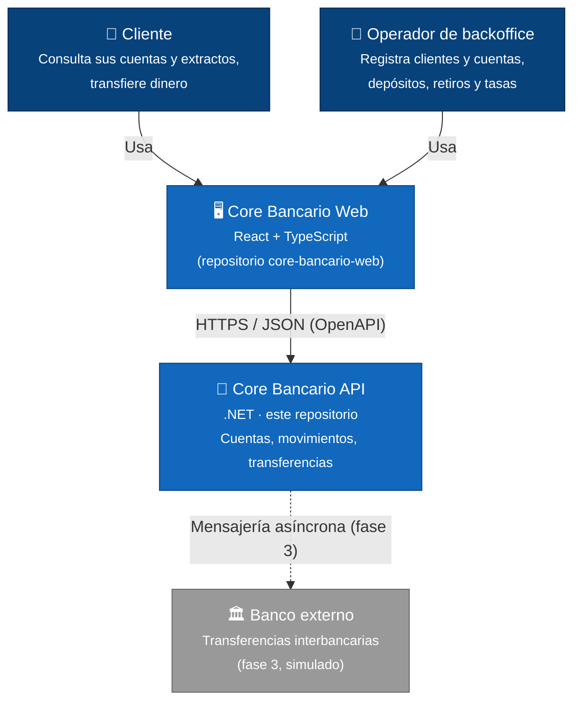

# Core Bancario

Core bancario simplificado en .NET: cuentas en COP y USD, transferencias internas que no se duplican y saldos que se mantienen consistentes bajo concurrencia. Proyecto de portafolio construido para **defender decisiones**: cada regla de negocio tiene una prueba, cada decisión técnica un ADR y cada escenario de falla una demostración automatizada.

> 🚧 En construcción. Estado actual: **Sprint 0 — Fundaciones**. Ver el [roadmap](docs/producto/roadmap.md).

## Qué demuestra

Al terminar la fase 1, este repositorio responde con código y pruebas:

- Por qué el saldo nunca queda negativo aunque lleguen dos transferencias al mismo tiempo.
- Por qué reintentar una transferencia no la ejecuta dos veces.
- Cómo se convierte dinero entre COP y USD sin perder centavos ni reescribir la historia.
- Qué alternativas se descartaron en cada decisión y por qué.

## Contexto del sistema (C4 nivel 1)



## Stack y decisiones

| Tema | Decisión | ADR |
|---|---|---|
| Proceso | Spec-Driven Development con agentes de Claude Code | [0001](docs/adr/0001-guiar-el-desarrollo-con-sdd.md) |
| Arquitectura | Clean Architecture | [0002](docs/adr/0002-clean-architecture-para-el-backend.md) |
| Base de datos | PostgreSQL | [0003](docs/adr/0003-postgresql-como-base-de-datos.md) |
| Acceso a datos | EF Core para escribir, Dapper para leer | [0004](docs/adr/0004-ef-core-para-escritura-y-dapper-para-lectura.md) |
| Repositorios | Backend y frontend separados | [0005](docs/adr/0005-repositorios-separados-backend-y-frontend.md) |
| Pruebas | xUnit v3 con Microsoft Testing Platform | [0006](docs/adr/0006-xunit-v3-con-microsoft-testing-platform.md) |

.NET 10 · xUnit v3 · Testcontainers · Docker · GitHub Actions.

## Cómo ejecutarlo

Requisitos: .NET 10 SDK y Docker.

```bash
cp .env.example .env        # ajusta las claves (PostgreSQL y el administrador de Keycloak)
docker compose up -d        # PostgreSQL y Keycloak locales
dotnet build
dotnet test
```

### Cadena de conexión de la API

La API lee `ConnectionStrings:CoreBancario`. **Nunca se guarda en el repositorio.** En desarrollo, usa user-secrets (la API ya tiene su `UserSecretsId`) o una variable de entorno:

```bash
dotnet user-secrets set "ConnectionStrings:CoreBancario" "Host=localhost;Port=5432;Database=core_bancario;Username=core_bancario;Password=<la de tu .env>" --project src/CoreBancario.Api
# o bien: export ConnectionStrings__CoreBancario="Host=localhost;..."
```

En `Development` la API aplica las migraciones al arrancar. Las pruebas de Infrastructure y Api usan Testcontainers, así que necesitan Docker en marcha.

## Autenticación con Keycloak

La API no emite credenciales: las emite **Keycloak** (ADR-0014) y la API solo valida los tokens (ADR-0015). Hay dos realms, `clientes` y `empleados`, que se importan solos desde [`infra/keycloak/realms`](infra/keycloak/realms). Los temas de la pantalla de ingreso están en [`infra/keycloak/themes`](infra/keycloak/themes).

### Levantar Keycloak y entrar a la consola

1. Rellena en `.env` `KC_BOOTSTRAP_ADMIN_USERNAME` y `KC_BOOTSTRAP_ADMIN_PASSWORD` (el administrador de la consola; elige tus propios valores) y `KC_CLIENTES_API_SECRET` (ver "Secreto de la cuenta de servicio").
2. `docker compose up -d`. El primer arranque de Keycloak tarda varios minutos (compila su configuración y crea los realms).
3. Abre `http://localhost:8080` (o el `KEYCLOAK_PORT` de tu `.env`) y entra a la consola de administración con ese usuario.

**Volumen de Keycloak antiguo.** El volumen `keycloak-data` se montaba en `/opt/keycloak/data/h2` y ahora se monta en `/opt/keycloak/data`. Si el tuyo tiene `keycloakdb.mv.db` en la raíz y no una carpeta `h2/` (`docker run --rm -v core-bancario_keycloak-data:/v alpine ls /v`), Keycloak **no da error**: crea una base nueva en silencio y pierdes los usuarios de prueba. Antes de arrancar, recrea el volumen ("Recargar un realm modificado") o mueve la base a `h2/`:

```bash
docker run --rm -v core-bancario_keycloak-data:/v alpine sh -c "mkdir /v/h2 && mv /v/keycloakdb.* /v/h2/ && chown -R 1000:0 /v"
```

En `Development` la API espera a Keycloak en `http://localhost:8080` (sección `Autenticacion` de `appsettings.Development.json`). Si cambias `KEYCLOAK_PORT`, ajusta `Autenticacion:Clientes:Emisor` y `Autenticacion:Empleados:Emisor` con user-secrets: el emisor debe ser **exactamente** el `iss` de los tokens.

### Crear un operador (realm `empleados`)

1. Consola → realm `empleados` → *Users* → *Add user*: escribe un nombre de usuario y guarda.
2. Pestaña *Credentials* → *Set password*, con *Temporary* desactivado (mínimo 12 caracteres y sin contener el usuario).
3. Pestaña *Role mapping* → *Assign role* → `operador`.

En su primer ingreso Keycloak le pedirá inscribir la app autenticadora (OTP): el segundo factor es obligatorio (RN-24).

### Secreto de la cuenta de servicio

Para habilitar y deshabilitar accesos, la API usa la cuenta de servicio `core-bancario-api-admin` del realm `clientes`, que solo puede gestionar y ver usuarios (ADR-0014). Su secreto **nunca** está en el repositorio: el realm trae el marcador `${KC_CLIENTES_API_SECRET}` y Keycloak lo resuelve con la variable de entorno al importar.

1. Genera un secreto largo y aleatorio (por ejemplo `openssl rand -hex 32`) y ponlo en `.env` como `KC_CLIENTES_API_SECRET`. Sin este valor `docker compose up` no arranca Keycloak.
2. Pon **el mismo valor** en los user-secrets de la API:

```bash
dotnet user-secrets set "Keycloak:Administracion:ClientSecret" "<el mismo secreto>" --project src/CoreBancario.Api
# o bien: export Keycloak__Administracion__ClientSecret="<el mismo secreto>"
```

Si ya tenías un volumen de Keycloak de antes de la 003b, el realm `clientes` no trae esta cuenta: recárgalo (sección siguiente).

### Habilitar el acceso de un cliente de prueba

Ya no hace falta crear al cliente a mano en la consola ni vincularlo con SQL:

1. Registra el cliente con `POST /clientes` usando el token de un operador y guarda su `id`.
2. Llama a `POST /clientes/{id}/acceso-digital/habilitar` con el token de un operador. La respuesta trae la `claveTemporal` (solo aparece ahí) para entregársela al cliente. El usuario se llama como su documento sin separadores, por ejemplo `CC1234567`.
3. El cliente entra con esa clave: Keycloak le pedirá cambiarla e inscribir su app autenticadora (OTP).

Llamar otra vez a `habilitar` sobre un acceso ya habilitado lo **restablece**: clave temporal nueva, segundo factor borrado y sesiones cerradas. `POST /clientes/{id}/acceso-digital/deshabilitar` lo deshabilita y cierra sus sesiones.

Para consultar el estado, `GET /clientes/{id}/acceso-digital` (operador; solo lectura, no escribe ni reconcilia) responde `estado` (`SinAcceso`, `Habilitado` o `Deshabilitado`) y, solo si está `Habilitado`, `primerIngresoPendiente` (`true` mientras Keycloak conserve la acción obligatoria de cambiar la clave o inscribir el OTP). Responde 404 si el cliente no existe y 502/503 si Keycloak falla.

### Solicitudes de acceso sin resultado

Cada habilitar o deshabilitar deja primero una **solicitud** en la base y después un **resultado** en otra fila; nada se edita ni se borra (RN-20, ADR-0017). Una solicitud sin resultado es una operación cuyo desenlace no se confirmó (por ejemplo, Keycloak no respondió). El siguiente intento sobre el mismo cliente las cierra solo, mirando la marca del usuario en Keycloak. Para auditar las que sigan abiertas:

```sql
SELECT s.id, s.cliente_id, s.operador, s.accion, s.fecha
FROM solicitudes_de_acceso s
LEFT JOIN resultados_de_acceso r ON r.solicitud_id = s.id
WHERE r.solicitud_id IS NULL
ORDER BY s.fecha;
```

### Errores 502 y 503 al gestionar accesos

| Estado | `codigo` | Qué pasó | Qué debe hacer el operador |
|---|---|---|---|
| 502 | `identidad-error` | Keycloak respondió con un error y la operación no se completó (pudo quedar a medias). La solicitud queda como `Fallido`. | Leer el `detail` de la respuesta (trae el mensaje fijo, no el motivo técnico) y volver a intentar la misma operación. Si se repite, avisar a quien administra Keycloak. |
| 503 | `identidad-sin-respuesta` | Keycloak no respondió (tiempo de espera o conexión). **No se sabe si se aplicó.** La solicitud queda pendiente. | Leer el `detail` y volver a intentar la **misma** operación: el reintento confirma o descarta la anterior. No entregar ninguna clave anterior; la que sirve es la de la respuesta 200. |

Un `422 acceso-no-habilitado` al deshabilitar significa que el cliente ya no tiene un acceso habilitado (por ejemplo, un intento anterior sí se aplicó).

### Recargar un realm modificado

Keycloak importa los realms **solo si no existen**: si cambias un JSON de `infra/keycloak/realms`, hay que borrar el volumen de Keycloak para que lo vuelva a importar (esto borra los usuarios de prueba):

```bash
docker compose rm -sf keycloak
docker volume rm core-bancario_keycloak-data   # el prefijo es el nombre de la carpeta del proyecto
docker compose up -d keycloak
```

Los temas sí se recargan en caliente: no hace falta borrar nada para ver un cambio en un tema.

### Contrato OpenAPI

El contrato se genera al compilar y se versiona en [`src/CoreBancario.Api/openapi/core-bancario-api.json`](src/CoreBancario.Api/openapi/core-bancario-api.json) (ADR-0019). El del BFF se explica en "Aplicación web y BFF". Si cambias un endpoint, compila y haz commit del archivo: el CI falla si el contrato versionado no está al día. En producción no se expone ninguna ruta de OpenAPI.

### Límites conocidos

Se aceptaron a propósito y están explicados en el [plan de la 003](specs/003-auth-api/plan.md):

- **La clave temporal no vence (CL-05).** Keycloak 26 no permite que una clave temporal caduque: sirve hasta que el operador restablece o deshabilita el acceso. Mejora futura: un proceso que deshabilite los accesos con la clave temporal sin usar tras 72 horas.
- **La pantalla del OTP confirma que la clave era correcta.** Es inherente al ingreso en dos pasos; lo mitiga el bloqueo, porque un OTP erróneo también cuenta como intento fallido.
- **Ventana de revocación de hasta 5 minutos.** La API valida el token sin consultar a Keycloak (270 s de vida + 30 s de tolerancia de reloj), así que un acceso deshabilitado o una sesión cerrada siguen sirviendo hasta que vence el token que ya se emitió.
- **El aviso del número de documento se puede saltar.** El navegador avisa si la clave nueva contiene el número de documento, pero un cliente sin JavaScript o una petición hecha a mano lo evitan. El servidor sí rechaza la clave que contiene el usuario completo (por ejemplo `CC1234567`).
- **El operador ve la clave temporal** que entrega al cliente.

## Aplicación web y BFF

La interfaz web vive en otro repositorio, [`core-bancario-web`](../core-bancario-web) (ADR-0005). Este repositorio pone el BFF (*backend for frontend*) que le da su sesión: [`src/CoreBancario.Bff`](src/CoreBancario.Bff), decidido en [ADR-0020](docs/adr/0020-bff-propio-en-net-para-la-sesion-del-navegador.md) y [ADR-0021](docs/adr/0021-inactividad-medida-por-el-bff-con-actividad-deliberada.md).

### Arquitectura

```
navegador ──▶ nginx (o Vite en desarrollo) ──▶ BFF ──▶ API ──▶ PostgreSQL
                  :5173, mismo origen            │
                                                 └──▶ Keycloak (inicio de sesión, renovación y cierre por el canal trasero)
```

- El navegador solo habla con **un origen** (`http://localhost:5173`): la SPA, `/bff/*` y `/api/*`. No hay CORS.
- El BFF inicia sesión con Keycloak como cliente **confidencial** (código de autorización con PKCE), guarda los tokens en el servidor y le entrega al navegador una cookie `HttpOnly` y `SameSite=Strict` que solo lleva una clave opaca.
- Para `/api/*`, el BFF añade `Authorization: Bearer` y reenvía a la API con YARP. La API no cambia su forma de validar tokens y ya no se expone al navegador.
- El BFF no tiene reglas de negocio ni referencia a Application o Domain: autentica, mide la sesión y reenvía.

### Por qué no hay tokens en el navegador

Un token que JavaScript puede leer lo puede robar cualquier script inyectado (XSS) y usarlo desde otro lugar durante los 5 minutos que vive. Aquí el token **nunca llega al navegador**: está en la memoria del BFF y el navegador solo tiene una cookie que JavaScript no puede leer. Contra el CSRF, la cookie es `SameSite=Strict` y todo `/api/*` y `/bff/*` exige además el encabezado `X-CSRF: 1` y un `Sec-Fetch-Site` igual a `same-origin`. Ningún `GET` cambia datos.

La inactividad la mide el BFF, no Keycloak: solo cuenta la actividad deliberada de la persona (`POST /bff/actividad`), nunca las peticiones automáticas de la interfaz. Todo inicio de sesión pide credenciales (`prompt=login`).

### Levantar todo con un comando

Requisito: los dos repositorios clonados **uno al lado del otro** (`core-bancario` y `core-bancario-web`), o `CORE_BANCARIO_WEB_DIR` en `.env` con la ruta del web.

```bash
docker compose --profile app --profile web up -d --build --wait
# http://localhost:5173
```

Sin perfiles, `docker compose up -d` sigue levantando solo PostgreSQL y Keycloak. El perfil `app` añade la API y el BFF (**sin puertos publicados**: solo se alcanzan desde la red de compose) y el perfil `web` añade nginx con la SPA, que es lo único publicado.

### Al actualizar desde la 003: recrear el volumen de Keycloak

La 004 cambia los realms (el cliente `core-bancario-web` pasa de público a **confidencial**, con redirecciones exactas hacia el BFF) y añade `KC_HOSTNAME`. Keycloak solo importa un realm si no existe, así que hay que **recrear el volumen** (esto borra los usuarios de prueba) y definir **dos secretos nuevos** en `.env`:

```bash
# 1. En .env, dos valores largos, aleatorios y distintos entre sí (por ejemplo: openssl rand -hex 32):
#    KC_WEB_CLIENTES_SECRET=...
#    KC_WEB_EMPLEADOS_SECRET=...
# 2. Recrear el volumen y volver a levantar:
docker compose down
docker volume rm core-bancario_keycloak-data   # el prefijo es el nombre de la carpeta del proyecto
docker compose up -d
```

Después, comprueba que el descubrimiento sigue publicando el emisor que ve el navegador: `curl http://localhost:8080/realms/clientes/.well-known/openid-configuration` debe traer `"issuer":"http://localhost:8080/realms/clientes"`.

### BFF fuera de Docker (`dotnet run`)

Con Vite en `http://localhost:5173` (su *proxy* envía `/bff` y `/api` al BFF en `http://localhost:5180`) y la API en `http://localhost:5096`. El secreto de cada realm es **el mismo valor** que pusiste en `.env`, y va en los user-secrets del BFF, nunca en `appsettings`:

```bash
dotnet user-secrets set "Bff:Clientes:ClientSecret" "<el valor de KC_WEB_CLIENTES_SECRET>" --project src/CoreBancario.Bff
dotnet user-secrets set "Bff:Empleados:ClientSecret" "<el valor de KC_WEB_EMPLEADOS_SECRET>" --project src/CoreBancario.Bff
dotnet run --project src/CoreBancario.Bff   # http://localhost:5180
```

Los tiempos de sesión (5 min de inactividad y 30 min de vida máxima para clientes; 15 min y 9 h para empleados) están en `src/CoreBancario.Bff/appsettings.json` y una prueba comprueba que coinciden con los de los realms.

### Contrato OpenAPI del BFF

Como el de la API, se genera al compilar y se versiona en [`src/CoreBancario.Bff/openapi/core-bancario-bff.json`](src/CoreBancario.Bff/openapi/core-bancario-bff.json) (ADR-0019). El CI falla si alguno de los dos contratos no está al día. Los contratos incluyen el catálogo de códigos de error (`CodigoDeError` y `CodigoDeErrorDelBff`) como *enum*, que es de donde el repositorio web saca sus tipos.

### Límites conocidos de la sesión

- **Las sesiones están en memoria.** Reiniciar el BFF cierra todas las sesiones, y no admite varias instancias (ADR-0020).
- **Revocación de hasta 270 s.** Si el operador deshabilita a un cliente que **no** está haciendo nada, su sesión se cierra cuando vence el access token. Si está activo, se nota en el siguiente latido.
- **Doble envío entre pestañas o por reintento de red (CL-15).** Dos pestañas o un reintento de red pueden abrir dos cuentas; lo cerrará la idempotencia de los sprints 4 y 5.

## Cómo se trabaja

Cada feature pasa por cuatro fases con aprobación del autor entre ellas: **Spec → Design → Build (pruebas primero) → Review**. Todo queda en el repositorio:

- [`docs/producto/spec-fase-1.md`](docs/producto/spec-fase-1.md): spec de producto con reglas de negocio, requisitos y escenarios de falla.
- [`docs/adr/`](docs/adr/): decisiones de arquitectura con las alternativas descartadas.
- `specs/NNN-feature/`: spec, plan, tareas, notas de aprendizaje y revisión de cada feature.
- [`docs/sdd/guia.md`](docs/sdd/guia.md): guía del flujo y de los agentes.

## Trade-offs y escenarios de falla

_Se completa a medida que avanzan los sprints: cada escenario de falla tendrá aquí su explicación y su prueba._
